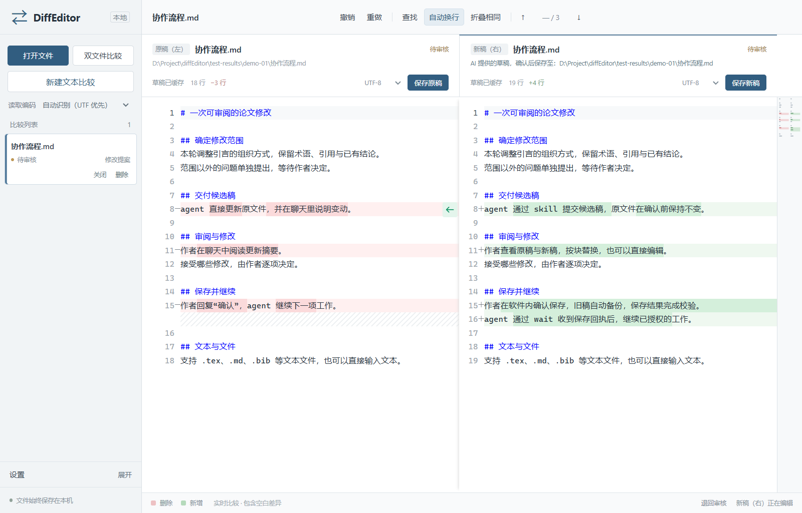
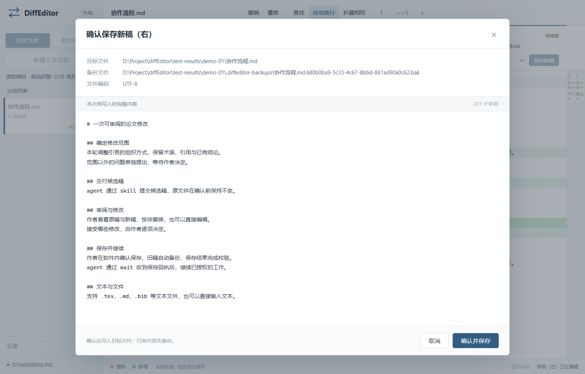

# DiffEditor

**让 AI 提出修改，由你决定保存什么。**

一款 Windows 文本差异查看与编辑器。可以直接比较文件或粘贴文本，也能通过配套 **diffeditor skill** 接收 agent 的候选稿，逐段审阅、按块替换或手动修改。

## 与 agent 一起改稿

**agent 提交草稿 → 你审阅、编辑 → 确认保存并备份旧稿 → agent 收到回执后继续。**

确认前，修改留在草稿中。你不用再回聊天补一句“我确认了”，也不必全盘接受 AI 的提案。

查看保存确认界面

## 开始使用

1. 解压 Windows 便携包，双击 `DiffEditor.exe`。
2. **自己比较：**打开 `.tex`、`.md`、`.bib` 等文本文件，或点击“新建文本比较”直接输入。
3. **交给 Codex：**将包内 `skill/diffeditor` 完整文件夹复制到 `%USERPROFILE%\.codex\skills\`，然后对它说：

> 使用 $diffeditor 修改这篇论文，提交给我审阅，等待我在软件内保存后再继续。

软件在本地运行，无需账号。skill 约束审阅流程，不改变 agent 的系统权限。

[使用说明](docs/guide.md) · [CLI 接入文档](docs/cli.md)
